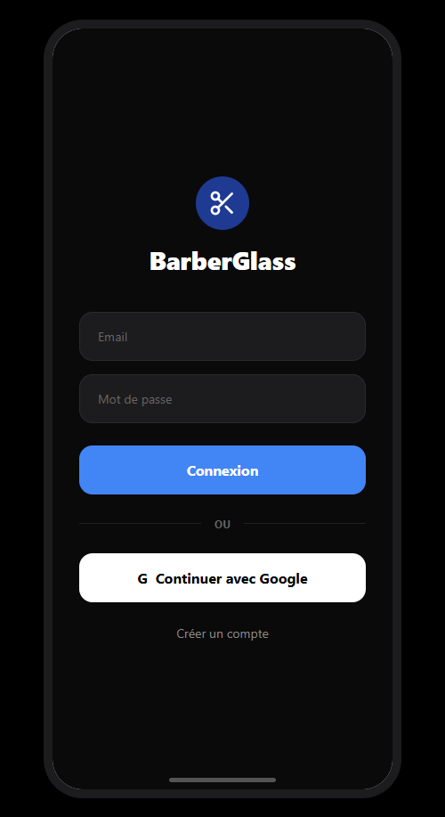

# BarberGlass (Hub-Hair)

<div align="center">
  
  <br/><br/>
  
  [](https://reactnative.dev/)
  [](https://expo.dev/)
  [](https://www.typescriptlang.org/)
  [](https://firebase.google.com/)
  [](https://nedjaryanis.github.io/hub-hair/)
</div>

<br/>

**BarberGlass** est une application mobile cross-platform (iOS, Android, Web) d?di?e ? la r?servation et ? la d?couverte de barbiers et salons de coiffure dans l'agglom?ration d'Orl?ans. L'application mise sur une interface moderne en **Glassmorphism**, des composants fluides et une architecture r?active connect?e ? **Firebase**.

---

## Fonctionnalit?s Principales

- **Interface Glassmorphism & UX Soign?e** : Composants translucides flout?s (`GlassContainer`, `expo-blur`) avec th?matique sombre ?l?gante.
- **Authentification S?curis?e** : Connexion par email/mot de passe et support OAuth Google via Firebase Authentication.
- **Cartographie & G?olocalisation** : D?couverte des barbiers locaux avec affichage interactif sur carte (`expo-location`).
- **Gestion des Profils & Salons** : Fiches d?taill?es des artisans (tarifs, horaires, prestations, avis).
- **Navigation Fluide** : Syst?me de navigation par onglets et piles (`@react-navigation`).

<div align="center">
  
  <br/>
  <sub>Aper?u de l'?cran d'accueil et d'authentification</sub>
</div>

---

## Architecture Technique

```text
src/
??? components/          # Composants UI r?utilisables (GlassContainer, Map)
??? contexts/            # Contextes React (AuthContext pour la session utilisateur)
??? data/                # Jeux de donn?es locaux (orleansBarbers.ts)
??? hooks/               # Hooks personnalis?s (useBarbers)
??? navigation/          # Configuration React Navigation (Tab & Stack)
??? screens/             # Vues principales (Home, Discovery, BarberProfile, Account, Login)
```

---

## Installation & D?marrage

### Pr?requis
- [Node.js](https://nodejs.org/) (version 18 ou sup?rieure)
- Gestionnaire de paquets [npm](https://www.npmjs.com/) ou [yarn](https://yarnpkg.com/)
- Application mobile **Expo Go** (sur smartphone) ou un ?mulateur

### 1. Cloner le d?p?t
```bash
git clone https://github.com/NedjarYanis/hub-hair.git
cd hub-hair
```

### 2. Installer les d?pendances
```bash
npm install
```

### 3. Lancer le serveur de d?veloppement
```bash
npx expo start
```

Scannez le QR Code affich? dans votre terminal avec l'application Expo Go (iOS/Android) ou appuyez sur `w` pour ouvrir la version Web dans votre navigateur.

---

## D?ploiement Web

L'application est configur?e pour un d?ploiement continu sur GitHub Pages via `gh-pages` :
```bash
npm run deploy
```
La version web est accessible sur : **[https://nedjaryanis.github.io/hub-hair/](https://nedjaryanis.github.io/hub-hair/)**

---

<div align="center">
  <sub>D?velopp? par Yanis Nedjar</sub>
</div>
