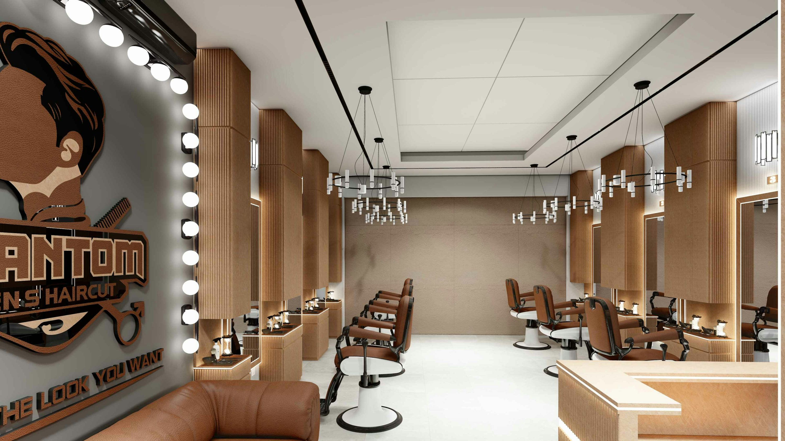

# BarberGlass (Hub-Hair)

<div align="center">
  
  <br/><br/>

  [](https://reactnative.dev/)
  [](https://expo.dev/)
  [](https://www.typescriptlang.org/)
  [](https://firebase.google.com/)
  [](https://nedjaryanis.github.io/hub-hair/)
</div>

<br/>

**BarberGlass** est une application mobile cross-platform (iOS, Android, Web) dédiée à la réservation et à la découverte de barbiers et salons de coiffure dans l'agglomération d'Orléans. L'application mise sur une interface moderne en **Glassmorphism**, des composants fluides et une architecture réactive connectée à **Firebase**.

---

## Fonctionnalités Principales

- **Interface Glassmorphism & UX Soignée** : Composants translucides floutés (`GlassContainer`, `expo-blur`) avec thématique sombre élégante.
- **Authentification Sécurisée** : Connexion par email/mot de passe et support OAuth Google via Firebase Authentication.
- **Cartographie & Géolocalisation** : Découverte des barbiers locaux avec affichage interactif sur carte (`expo-location`).
- **Gestion des Profils & Salons** : Fiches détaillées des artisans (tarifs, horaires, prestations, avis).
- **Navigation Fluide** : Système de navigation par onglets et piles (`@react-navigation`).

<div align="center">
  
  <br/>
  <sub>Aperçu de l'écran d'accueil et d'authentification</sub>
</div>

---

## Architecture Technique

```text
src/
├── components/          # Composants UI réutilisables (GlassContainer, Map)
├── contexts/            # Contextes React (AuthContext pour la session utilisateur)
├── data/                # Jeux de données locaux (orleansBarbers.ts)
├── hooks/               # Hooks personnalisés (useBarbers)
├── navigation/          # Configuration React Navigation (Tab & Stack)
└── screens/             # Vues principales (Home, Discovery, BarberProfile, Account, Login)
```

---

## Installation & Démarrage

### Prérequis
- [Node.js](https://nodejs.org/) (version 18 ou supérieure)
- Gestionnaire de paquets [npm](https://www.npmjs.com/) ou [yarn](https://yarnpkg.com/)
- Application mobile **Expo Go** (sur smartphone) ou un émulateur

### 1. Cloner le dépôt
```bash
git clone https://github.com/NedjarYanis/hub-hair.git
cd hub-hair
```

### 2. Installer les dépendances
```bash
npm install
```

### 3. Lancer le serveur de développement
```bash
npx expo start
```

Scannez le QR Code affiché dans votre terminal avec l'application Expo Go (iOS/Android) ou appuyez sur `w` pour ouvrir la version Web dans votre navigateur.

---

## Déploiement Web

L'application est configurée pour un déploiement continu sur GitHub Pages via `gh-pages` :
```bash
npm run deploy
```
La version web est accessible sur : **[https://nedjaryanis.github.io/hub-hair/](https://nedjaryanis.github.io/hub-hair/)**

---

<div align="center">
  <sub>Développé par Yanis Nedjar</sub>
</div>
