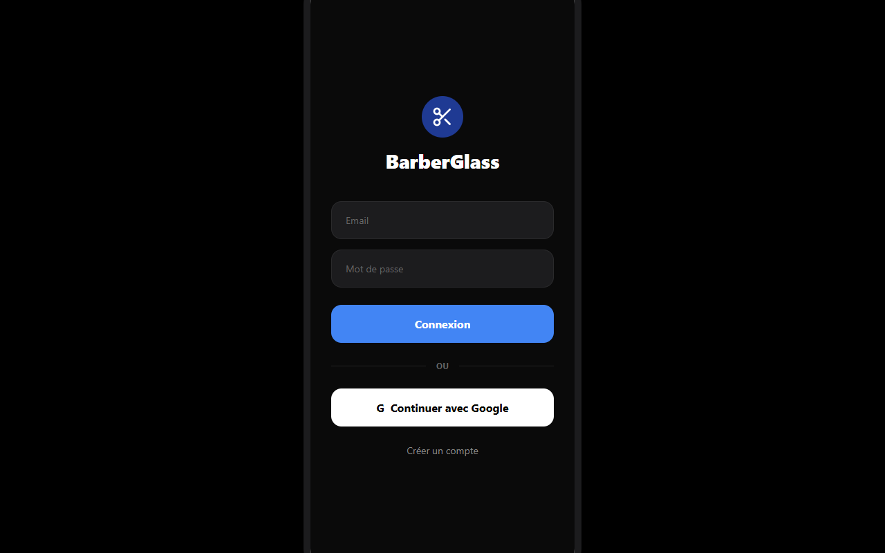

# BarberGlass (Hub-Hair) — Application Mobile de Réservation

<p align="center">
  <a href="https://reactnative.dev/"></a>
  <a href="https://expo.dev/"></a>
  <a href="https://www.typescriptlang.org/"></a>
  <a href="https://firebase.google.com/"></a>
  <a href="https://nedjaryanis.github.io/hub-hair/"></a>
</p>

<div align="center">
  <a href="https://nedjaryanis.github.io/hub-hair/">
    
  </a>
</div>

<br/>

Application mobile cross-platform (iOS, Android, Web) dédiée à la réservation en temps réel de créneaux chez les barbiers et salons de coiffure partenaires. L'interface propose un design moderne fondé sur le principe du **Glassmorphism**, offrant fluidité et lisibilité.

---

## Démo Web

La version web de l'application est consultable à l'adresse suivante :  
**[https://nedjaryanis.github.io/hub-hair/](https://nedjaryanis.github.io/hub-hair/)**

---

## Fonctionnalités Principales

- **Authentification & Gestion des Profils** : Inscription et connexion sécurisées via **Firebase Authentication** (clients et professionnels).
- **Catalogue des Salons & Prestations** : Consultation détaillée des barbiers, tarifs des coupes, durées estimées et avis clients.
- **Système de Réservation en Temps Réel** : Sélection interactive de créneaux avec synchronisation instantanée via **Cloud Firestore**.
- **Géolocalisation & Carte Interactive** : Localisation des salons à proximité grâce à `react-native-maps` et `expo-location`.
- **Interface Glassmorphism** : Composants visuels translucides avec flous d'arrière-plan (`@react-native-community/blur`), animations réactives et mode sombre natif.

---

## Architecture & Technologies

- **Frontend Mobile** : React Native avec le workflow managé **Expo** (SDK 52) pour une portabilité optimale.
- **Typage & Rigueur** : Codebase intégralement écrite en **TypeScript** avec interfaces strictes pour les modèles de données (utilisateurs, réservations, salons).
- **Backend Serverless** :
  - **Firebase Auth** pour la gestion des sessions utilisateur.
  - **Cloud Firestore** comme base de données NoSQL temps réel avec règles de sécurité strictes.
  - **Firebase Storage** pour le stockage des photographies de profil et des réalisations des barbiers.

---

## Structure du Code

```text
hub-hair/
├── app/                  # Routes et écrans applicatifs (Expo Router)
│   ├── (auth)/           # Écrans d'authentification (Connexion, Inscription)
│   ├── (tabs)/           # Navigation principale par onglets (Accueil, Salons, Réservations, Profil)
│   └── modal/            # Modales de confirmation de réservation et détails
├── components/           # Composants réutilisables (GlassCard, Button, CalendarPicker)
├── constants/            # Thème de couleurs, typographie, espacements
├── hooks/                # Hooks React personnalisés (useAuth, useSalons, useBookings)
├── services/             # Clients Firebase (config, authService, firestoreService)
└── types/                # Déclarations des interfaces TypeScript
```

---

## Lancement du Projet en Local

```bash
# Cloner le projet
git clone https://github.com/NedjarYanis/hub-hair.git
cd hub-hair

# Installer les dépendances
npm install

# Démarrer le serveur Expo
npx expo start
```

Scannez ensuite le QR code généré avec l'application **Expo Go** (sur iOS ou Android) ou appuyez sur `w` pour lancer la version web dans votre navigateur.

---

## Auteur

Projet développé par **[Yanis Nedjar](https://github.com/NedjarYanis)** — Développeur Logiciel & Web.
